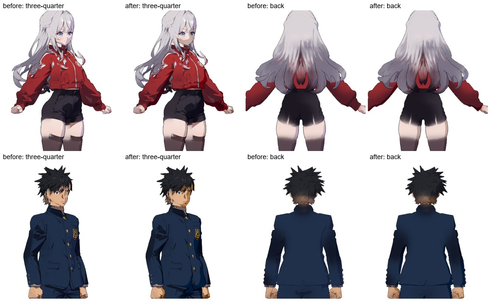

# Research notes (2026-11-07)

## Anima Turbo v1.1
- Official file: `circlestone-labs/Anima` → `split_files/diffusion_models/anima-turbo-v1.1.safetensors` (4.18 GB).
- Text encoder: `split_files/text_encoders/qwen_3_06b_base.safetensors`. VAE: `split_files/vae/qwen_image_vae.safetensors`.
- Architecture: derivative of NVIDIA Cosmos-Predict2-2B with a Qwen3-0.6B text encoder. Native in ComfyUI only (no official diffusers pipeline).
- Turbo settings (model card): CFG 1, 8–12 steps, euler, 512²–1536². Distillation gives a strong default style but less diversity.
- Prompts: Danbooru tags (lowercase, spaces) and/or natural language. Prefix `masterpiece, best quality, score_7, safe`. Artist tags need `@`.
- License: CircleStone Labs Non-Commercial (the model card says outputs are not restricted).
- Low-VRAM GGUF quantizations: `vanes430/Anima-Turbo-V1.1-GGUF` (needs ComfyUI-GGUF, recommends euler + sgm_uniform, 4–8 steps).

## Image → 3D
- **TRELLIS.2** (Microsoft, MIT): native ComfyUI core nodes since 0.34.0 (PR #14718, Aug 2026). No CUDA compilation.
  - Files in `Comfy-Org/TRELLIS.2`: `trellis_2_int8_convrot`, shape and texture VAEs, DINOv3 for clip_vision. Background removal: `Comfy-Org/BiRefNet`.
  - Output: GLB with baked base color, normal and AO. Template: "Pixal3D & TRELLIS.2: Image to Model".
  - Upstream repo needs ≥24 GB VRAM and Linux. The int8 native build's VRAM is still unmeasured (issue #4).
- **Pixal3D**: closer alignment to the input image, but the HF card gates out EU users. **Not used.**
- **Hunyuan3D 2.1**: license excludes the EU, UK and South Korea. **Not used.**
- **StdGEN** (anime-specific, semantic parts): an option to revisit if TRELLIS.2 struggles with anime input.

## 2D look in Blender
- Reference: Vertex Arcade, "Making 3D Look Like 2D in Blender" (https://www.youtube.com/watch?v=eHddD5OfuwI).
- Headless EEVEE on Linux needs OpenGL/EGL and is unreliable in containers. Cycles GPU works headless, so the shader avoids EEVEE-only nodes.

### Guilty Gear Xrd (reference for "perfect anime" 3D)
Videos the owner shared: Noggi, "I Studied How Guilty Gear Makes 3D Look Perfectly 2D" (https://www.youtube.com/watch?v=tWcaQ3gCbUU). Bran Sculpts, "Making an Anime character in 3D!" (https://www.youtube.com/watch?v=AWocxbVD3CE).

The primary source is Junya Motomura's GDC 2015 talk "GuiltyGearXrd's Art Style: The X Factor Between 2D and 3D". The handout PDF on ggxrd.com refused connections (2026-11-07), so the points below come from a summary of the talk (videohighlight.com/v/yhGjCzxJV3E):
- "Kill everything 3D". A 2D look comes from hand-made decisions, not from physically correct results.
- **Edited vertex normals**: automatic normals don't give clean anime shadow shapes, faces above all. Normals are kept at unit length.
- **Two colour textures**: base (lit) and tint (shadow), so every pixel has its own shadow colour. No specular map.
- **Vertex colours (RGBA)** drive the lighting threshold (shadow bias) and the outline. Self-shadowing was dropped as uncontrollable; shadow areas are painted instead.
- **Inverted-hull outline**, controlled per vertex. **Inner lines** are drawn into textures, with the UV layout set up so the lines stay sharp up close.
- **Limited animation**: every frame is a key pose (no smooth in-betweens). Models are deformed per pose.
- **Fixed character light rig**, independent of stage lighting. Textures are point sampled.

Bran Sculpts' Blender workflow (80.lv interview, 2024-03-12):
- Emission material.
- Grease Pencil **Line Art** modifier for the outlines.
- Edges marked with "Mark Freestyle" for extra inner lines.
- Hand-painted ink lines mixed into the emission colour.

What this pipeline can automate (it has no hand-authored data):
- Smooth or transfer shading normals from a simplified copy, for cleaner cel shapes. This stands in for hand-edited normals.
  - Done (#23): vertex normals blurred along the surface (seams welded first) go into a `toon_normal` attribute; ToonShade's "Smooth Normals" input blends between them and the mesh normals. `--normal-smooth` sets the blur radius as a fraction of the model height. Blurring the normals directly avoids the shrinking of a smoothed copy (fingers and hair strands collapse) and needs no Data Transfer modifier.
- Derive a per-pixel shadow colour from the base texture (a hue-shifted, more saturated darker tone) instead of one flat tint.
  - Done (#21): one cool tint turned skin shadows mauve. The tint now fades out as the base colour gets more saturated: colourful parts darken in their own hue (skin goes rosy, red goes crimson), greyish parts (silver hair, white, black) take the cool tint. Then the saturation is raised ×1.35. Tint, saturation, hue shift and strength are ToonShade inputs.
- Turntable timing on twos or threes.
  - Done (#22): `--hold 2|3` keys a new pose every N frames (constant interpolation) and `--ease` lingers on the front and back views.

- Optional Freestyle lines for creases. Freestyle is CPU-based, so it works with headless Cycles. Grease Pencil Line Art needs the GPU draw engine, like EEVEE.
- The Anima image's own line art already survives into the TRELLIS.2 texture bake.

## Colab Pro
- L4 (24 GB) ≈ 1.7–2 CU/h; A100 ≈ 11–15 CU/h; Pro = 100 CU/month. GPU type is not guaranteed.

## Tooling
- Colab MCP (official): `uvx git+https://github.com/googlecolab/colab-mcp`. Proxies to a browser Colab tab; one client at a time.
- Blender MCP: `uvx blender-mcp` plus `addon.py` in Blender (socket server).
